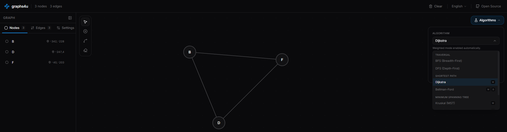

# graphs4u

> Open-source graph algorithm visualizer — create, edit, and run algorithms on graphs interactively.


## Features

- **Interactive Graph Board** — SVG-based canvas with pan, zoom, and grid
- **Node Management** — Click to add nodes, drag to reposition, inline label editing
- **Edge Management** — Click two nodes to connect them, with support for directed and weighted graphs
- **11 Algorithms** — BFS, DFS, Dijkstra, Bellman-Ford, A*, Floyd-Warshall, Kruskal, Prim, topological sort, connected components and maximum flow (Edmonds-Karp)
- **Learn Pages** — A prerendered page per algorithm, in English and Portuguese, with complexity, pseudocode, worked example and FAQ
- **Share by Link** — The whole graph is encoded in the URL, so any graph can be shared without an account
- **Templates** — Ready-made graphs (K5, K3,3, binary tree, Petersen, 3×3 grid, weighted cycle)
- **Import / Export** — DOT (Graphviz), adjacency matrix, edge list, and PDF export
- **Tools** — Select, Add Node, Add Edge, and Delete tools with keyboard shortcuts
- **Dark Mode** — Minimalist dark UI designed for focus
- **Sidebar** — Manage nodes, edges, and graph settings from a collapsible panel

## Getting Started

```bash
# Install dependencies
npm install

# Start dev server
npm run dev
```

## Keyboard Shortcuts

| Key | Action |
|-----|--------|
| `V` | Select tool |
| `N` | Add Node tool |
| `E` | Add Edge tool |
| `D` | Delete tool |
| `Del` / `Backspace` | Delete selected |
| `Esc` | Clear selection |
| `Shift + Click` | Multi-select |
| `Scroll` | Zoom in/out |

## Tech Stack

- **React 19** with TypeScript (strict mode)
- **Tailwind CSS v4** with CSS custom properties for theming
- **Tailwind Variants** for component variant styling
- **Tailwind Merge** for class merging
- **Lucide React** for icons
- **React Router + vite-react-ssg** for routing and build-time prerendering

## Project Structure

```
src/
├── components/
│   ├── board/           # Graph canvas and toolbar
│   ├── graph/           # Static graph rendering for content pages
│   ├── layout/          # Header, footer, dialogs
│   ├── seo/             # Per-page meta, hreflang and JSON-LD
│   ├── sidebar/         # Sidebar panel, node/edge lists, settings
│   └── ui/              # Reusable UI primitives
├── content/             # Bilingual algorithm content
├── contexts/            # Graph and i18n providers
├── layouts/             # Per-language route layout
├── pages/               # Board, algorithm and index pages
├── stores/              # Graph state (Context + useReducer)
├── types/               # TypeScript type definitions
├── lib/                 # Algorithms, routing, serialization, formats
├── routes.tsx           # Route table (prerendered per language)
└── main.tsx             # Entry point
```

Pages are prerendered to static HTML at build time with `vite-react-ssg`, then hydrated as a SPA. `scripts/postbuild.mjs` generates the sitemap, writes the GitHub Pages 404 fallback and checks that `CNAME` survives into `dist`.

## Contributing

See [CONTRIBUTING.md](CONTRIBUTING.md) for guidelines on how to open issues and submit pull requests.

## License

MIT — see [LICENSE.md](LICENSE.md) for details.
